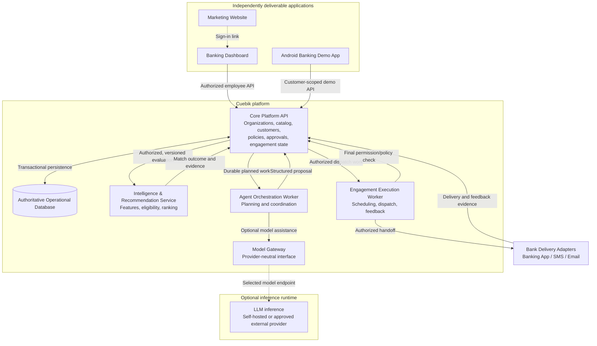
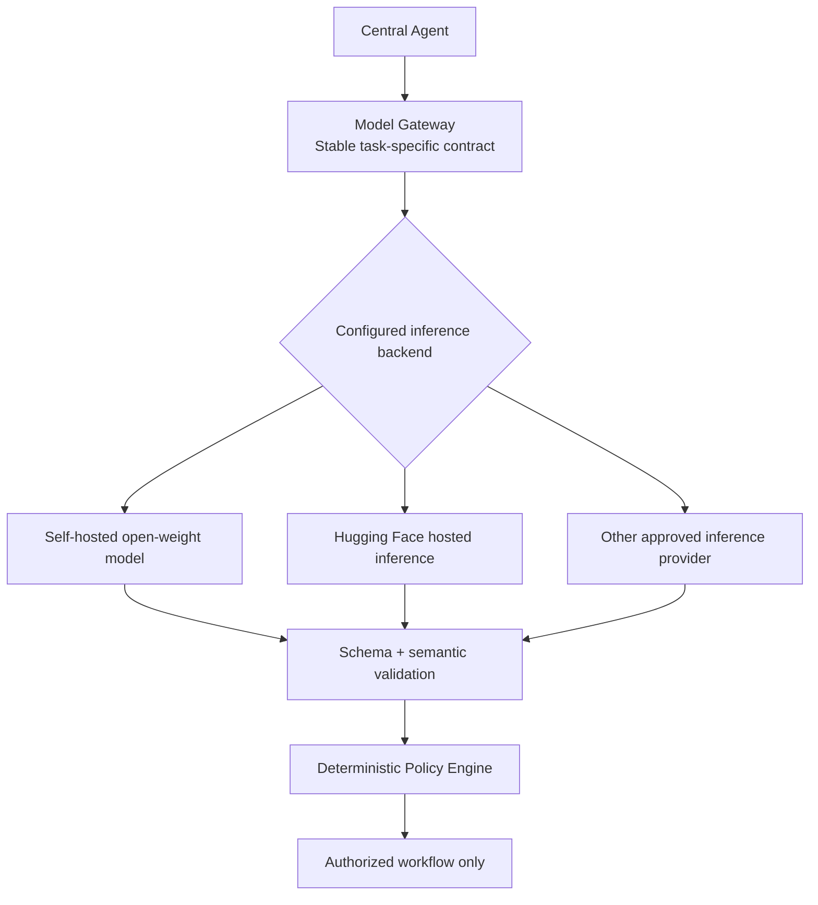

# Cuebik — System Architecture

**Version:** 0.2.0  
**Status:** Working draft — provisional technology and service-boundary design; no stack approved  
**Updated:** 11 October 2026

> **Document scope:** This document records proposed technology candidates and service boundaries for review. Neither the stack nor the deployment architecture is finalized. Product requirements remain governed by PRODUCT.md. The architecture must be validated against representative workloads, integration and security requirements, and engineering review before it becomes an implementation mandate.

## 1. Provisional technology selection

The following table records the current leading candidates, the product-specific reasons for considering them, and our confidence in their suitability. **No selection in this table is final.**

| Product responsibility | Leading candidate | Why it fits Cuebik | Confidence |
| --- | --- | --- | --- |
| **Operational database** | PostgreSQL | Strong transactional integrity for recommendations, approvals, policies, and engagement records; supports bank-level data isolation. | High |
| **Backend language** | Python | Extensive ecosystem for customer intelligence, financial data processing, machine learning, and recommendation logic. | High |
| **Backend framework** | Django + Django Ninja; FastAPI as alternative | Django provides mature data management, transactions, and authentication; Django Ninja adds typed APIs. FastAPI offers a leaner API-first alternative. | Medium |
| **Data validation & API contracts** | Typed schemas + OpenAPI | Keeps the banking dashboard, Android app, and backend aligned through explicit, validated request and response contracts. | High |
| **Customer feature processing** | Python data ecosystem (Polars, pandas, NumPy) | Transforms permitted financial and behavioural signals into usable customer features for matching. | High |
| **Recommendation Engine** | Eligibility rules + ranking model | Keeps mandatory bank product restrictions separate from relevance scoring so an ineligible product cannot qualify merely because it scores highly. | High |
| **ML tooling** | scikit-learn; LightGBM where justified | scikit-learn supports explainable baselines and evaluation; LightGBM may improve ranking if appropriate labeled data supports it. | Medium |
| **Central Agent** | Structured orchestration + selective LLM use | Coordinates whether, when, and how to propose engagement while keeping sensitive authorization decisions outside an LLM. | Medium |
| **Policy evaluator** | Versioned deterministic rules | Produces testable, predictable Automate / Review / Withhold decisions under bank-defined restrictions. | High |
| **Background execution** | PostgreSQL-backed jobs; Temporal alternative | Supports scheduled engagements, ingestion, and retries; Temporal warrants evaluation for complex, long-running workflows. | Medium |
| **Web frontend** | React + TypeScript | Supports an interactive banking dashboard with reusable components and typed application data. | High |
| **Web framework** | Next.js or Vite | Next.js can serve the public website and dashboard together; Vite may simplify a predominantly client-heavy dashboard. | Medium |
| **Android banking app** | Kotlin Compose or React Native + Expo | Kotlin provides a native Android experience; React Native offers cross-platform development and possible TypeScript reuse. | Medium |
| **Authentication** | Managed B2B identity or framework-based authentication | Provides controlled employee access while allowing for eventual enterprise identity and organization membership management. | Open |
| **Hosting & deployment** | Managed containers + managed PostgreSQL | Can run API and background workers independently while supporting persistent storage and controlled deployments. | Medium |
| **Observability** | OpenTelemetry-compatible instrumentation | Enables tracing and diagnosis across recommendation, agent, policy, approval, and engagement processing. | High |

### 1.1 How to interpret confidence

- **High:** Strong fit to the currently defined product requirements; still subject to design and operational validation.
- **Medium:** Credible leading approach, but alternatives must be compared against constraints or prototypes.
- **Open:** Insufficient evidence or unresolved requirements prevent a preferred selection.

Confidence is **not** a benchmark result, a production-readiness claim, or approval to implement a candidate.

### 1.2 Important distinctions

1. **High confidence does not mean finalized.** For example, PostgreSQL and Python are strong candidates, but deployment constraints and representative workloads still need examination.
2. **Some rows describe architectural approaches rather than individual products.** The Recommendation Engine, Central Agent, and policy evaluator require internal design decisions before their supporting libraries can be selected.
3. **Choices must be evaluated as a system.** The backend framework, database access, background execution, and authorization mechanisms must work together correctly. The same applies to model training, inference, and agent orchestration.

## 2. Proposed application and service boundaries

The product has three client experiences and several distinct platform responsibilities. Cuebik should support independently deployable applications **without treating every product module as an independent microservice**. Organization-scoped authorizations, catalog versions, policy evaluation, approvals, and engagement state require a shared transactional authority.

### 2.1 Editable service diagram

This Mermaid diagram renders natively in GitHub. It represents the proposed functional and deployable boundaries, not deployed infrastructure or real bank integrations.



**Important boundaries:**
- The public website is separate from the authenticated operational dashboard; it does not need customer data access.
- The Android app portrays a bank customer experience, not a mobile version of the bank staff dashboard. It requires customer-scoped access only.
- The Core Platform API owns authorized transactional state and applies final authorization. External compute services cannot directly grant approvals or send engagements on their own.
- The Recommendation Service returns structured **Recommend / Clarify / Suppress** decisions and evidence. It does not own approval, policy or delivery records.
- The Agent Worker proposes **whether/when/how**. The Engagement Worker handles scheduled handoffs and feedback, but must revalidate current permissions and policy before external delivery.
- The Model Gateway may initially be a module inside the Agent service. A separate LLM serving runtime exists only when needed (for self-hosting); external hosted inference is an alternative.
- The diagram is logical: exact protocols, worker infrastructure, network trust boundaries and database topology remain undecided.

### 2.2 Deployment responsibilities and their justification

| Component | Proposed boundary | Why |
| --- | --- | --- |
| **Marketing website** | Independent web application and deployment | Content, SEO, caching and release cadence differ from internal banking operations. |
| **Banking dashboard** | Independent authenticated web application and deployment | Bank staff need rich, secured operations independent of public site releases. |
| **Android banking app** | Independent native/cross-platform client and build | Customers use their bank's experience, not Cuebik employee accounts. |
| **Core Platform API** | Independent backend deployment | Owns authoritative bank-scoped data and consequential policy/approval/engagement transitions. |
| **Intelligence & Recommendation Service** | Independently testable Python service; separate deployment candidate | Feature processing and ML evaluation may require independent resources and model release cycles. |
| **Agent orchestration** | Separate worker runtime; independent deployment if justified | Planning and optional language inference should not block interactive requests. |
| **Engagement execution** | Separate worker runtime; independent deployment if justified | Scheduling, retries, acknowledgements and idempotency require dedicated execution control. |
| **LLM inference** | Optional separate inference runtime, or approved hosted provider | Hardware sizing and model upgrades should not dictate releases of the Core API. |
| **Catalog, Customers, Policies and Approvals** | Modules in the Core Platform API initially | Shared transaction, version and authorization requirements make premature decomposition risky. |

**A folder is not automatically a standalone service.** Meaningful independence requires an explicit contract, build/test configuration, well-defined data ownership and operational responsibility. No independent service may use another service's private database tables as an undocumented API.

The Core API must preserve references to input evidence, product versions, policy versions, authorization decisions and status events. A scheduled or retried job must not send a message under stale consent, approval or product terms. The exact outbox, locking and idempotency mechanisms remain for evaluation.

## 3. Proposed repository structure

One repository can support separate build and release pipelines. The layout below is a **proposal**, not a claim that these directories exist today.

```text
cuebik/
├── BRAND.md
├── DESIGN.md
├── PRODUCT.md
├── ARCHITECTURE.md
├── apps/
│   ├── marketing/            # Public website
│   ├── dashboard/            # Bank operations dashboard
│   └── bank-demo/            # Android customer experience
├── services/
│   ├── core-api/             # Transactional authority
│   ├── intelligence/         # Feature and recommendation evaluation
│   ├── agent/                # Agent orchestration + model gateway
│   ├── engagement-worker/    # Scheduling and delivery adapters
│   └── llm-inference/        # Optional self-hosted model server
├── packages/
│   ├── contracts/            # Versioned schemas and generated clients
│   └── ui/                   # Shared web-only UI components if useful
├── infrastructure/           # Independent service deployment definitions
└── assets/
    └── brand/                # Approved SVG identity assets
```

Each deployed application should be independently testable, configurable and releasable. Shared contracts must make API/worker boundaries explicit. Sharing code packages does not imply sharing the entire deployment. Scoped coding-agent files can be added once implementation decisions are approved; they are not part of this documentation change.

## 4. Python and intelligence components

**Working direction:** Python is the leading language for most of the backend because Cuebik processes structured banking signals, evaluates eligibility and develops reproducible ranking logic. This does **not** yet approve Django, FastAPI, a particular ML model or any individual deployment framework.

| System | Language/runtime direction | Reason |
| --- | --- | --- |
| Core Platform API | Python candidate | Strong data-domain, API, transaction and ML-adjacent ecosystem. |
| Customer ingestion & feature engineering | Python numerical/data ecosystem | Normalize authorized financial activity and track facts, inferences, freshness and missing values. |
| Eligibility & Recommendation Engine | Python rules and ranking | Hard product restrictions must remain separate from statistical relevance. |
| Training & evaluation | Python ML tooling | Supports repeatable baselines and measured model comparisons; learned ranking requires appropriate labels. |
| Central Agent | Python orchestration, optional LLM assistance | Coordinates structured proposals and model calls without giving the model authority. |
| Policies & Automation | Deterministic, versioned rule evaluation | Enforce **Automate / Review / Withhold** independent of generative model output. |
| Engagement execution | Background worker (Python candidate) | Handle scheduled sends and feedback while protecting authorization and delivery correctness. |
| LLM serving | Dedicated model runtime or hosted endpoint | Inference compute, model lifecycle and security differ from ordinary backend APIs. |
| Client applications | Separate technology evaluation | Browser and Android requirements are distinct from server-side processing. |

**Do not equate the Recommendation Engine with an LLM.** It must evaluate authorized customer evidence against currently active products, eligibility restrictions and potentially a ranking model, returning **Recommend / Clarify / Suppress** and evidence. The agent may assist with proposals or wording; neither model output nor an earlier recommendation authorizes contact.

## 5. Model Gateway and provider portability

**Architectural requirement:** Cuebik must be able to replace an LLM or hosting provider without rewriting the Central Agent, policy evaluator or engagement workflow. The internal Model Gateway presents a stable interface regardless of whether selected model weights run on our infrastructure, a managed dedicated endpoint or another permitted hosted provider.



### 5.1 What the gateway owns

- **Provider routing:** Select model/provider/revision and endpoint from protected configuration; do not hardcode vendor calls in agent business logic.
- **Stable contracts:** Accept permitted context/allowed actions and return a typed, structured proposal rather than executable permission.
- **Validation:** Check response schema and business semantics; reject invented rates, unsourced claims, disallowed channels, unsupported evidence references and invalid action types.
- **Reliability:** Normalize timeouts, failures, rate limits and bounded retries. A failed model call must not authorize engagement.
- **Traceability:** Record model/provider/prompt versions, request IDs and evaluation metadata without logging sensitive customer content unnecessarily.
- **Migration safety:** Test a replacement on the same Cuebik-specific task suite before activating it; API compatibility alone does not guarantee equivalent output or tool calling.

A gateway can be an internal agent module initially. Independent deployment becomes a separate operational decision. The LLM may propose content or action; the Policy Engine remains the authority for **Automate / Review / Withhold**, and the Core API validates the final dispatch state.

### 5.2 Where Hugging Face fits

Hugging Face is **a model discovery, distribution and inference platform**, not one mandatory model that Cuebik must use.

| Hugging Face capability | How Cuebik could use it | Important qualification |
| --- | --- | --- |
| **Model Hub** | Discover, evaluate and download open-weight models; inspect licenses, model cards and pinned revisions. | Licenses, gated access, suitability and model-code risks differ by model. |
| **Inference Providers** | Evaluate hosted models with a common Python/HTTP interface without first operating GPUs. | Requests are routed via Hugging Face and real inference providers; review privacy, geography, billing and provider-specific behaviour. |
| **Dedicated Inference Endpoints** | Deploy an approved model through managed compute with selected hardware and scaling. | Dedicated managed inference is still third-party hosting; region and network security require review. |
| **Self-hosted downloaded models** | Serve licensed weights using a chosen runtime such as vLLM where supported. | Requires compute, monitoring, secure serving, licensing checks and model version management. |

Relevant official references:
- Hugging Face Model Cards: https://huggingface.co/docs/hub/model-cards
- Hugging Face Gated Models: https://huggingface.co/docs/hub/models-gated
- Hugging Face Inference Providers: https://huggingface.co/docs/inference-providers/index
- Hugging Face Inference Endpoints: https://huggingface.co/docs/inference-endpoints/about
- Hugging Face Endpoint security: https://huggingface.co/docs/inference-endpoints/security
- vLLM compatible API/security: https://docs.vllm.ai/en/latest/serving/online_serving/openai_compatible_server/

**Decision state:** Hugging Face is a candidate for discovery, testing and optional inference—not a required provider. No specific model, hosting provider, fine-tuning approach or GPU deployment is approved.

### 5.3 Model and customer-data safeguards

External inference changes where bank-derived data is processed. Apply data minimization; avoid raw credentials, full banking histories or sensitive identifiers for message drafting; assess actual service contracts, retention, routing, residency and access controls before using real data. Self-hosted inference still requires model provenance, dependency and runtime security reviews. Invalid/unavailable model output fails safely, without assuming permission.

## 6. Evaluation status and next steps

**Agreed direction for design discussion:** Separately deliverable marketing/dashboard/Android apps; a core transactional authority; independently runnable intelligence, agent and engagement work; deterministic authorization; provider-neutral model access.

**Not finalized:** Exact technology stack, backend framework, frontend/mobile tools, service topology, queue/broker choice, database deployment, machine-learning and language models, hosted versus self-hosted inference, infrastructure provider and cost/performance targets.

Before approving implementation choices, evaluate:
1. **Workflow correctness:** consent/policy/product changes after approval, concurrent decisions, retries, duplicate delivery, recovery and auditability.
2. **Recommendation quality:** labeled evidence, representative scenarios, eligibility accuracy, explanation quality and learned-versus-baseline ranking.
3. **Model portability:** provider/model conformance, licensing, data handling, cost, latency and fallback behaviour.
4. **Workload and scaling:** bank count, customers, products, event frequency, evaluation throughput and latency expectations.
5. **Interfaces and security:** service data ownership, typed/versioned contracts, organization isolation, authentication and private network boundaries.
6. **Operations:** deployments, secrets, recovery, monitoring, regional requirements and engineering team expertise.

Promote proposals to binding technical decisions only after explicit review and validation.
