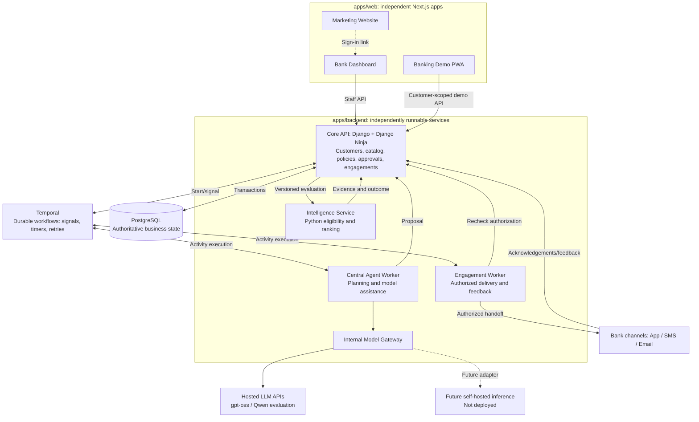
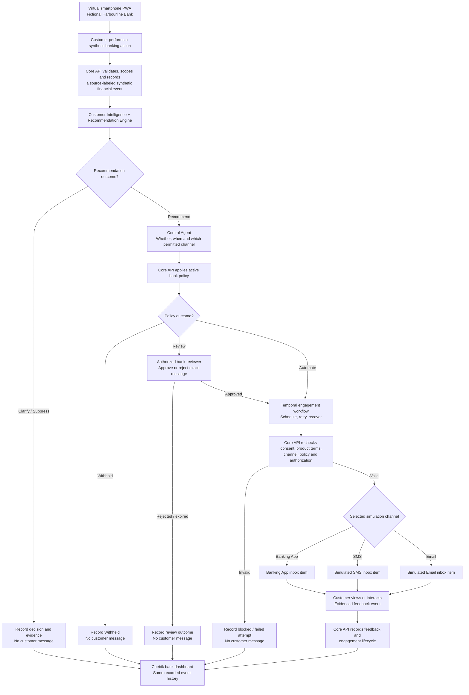
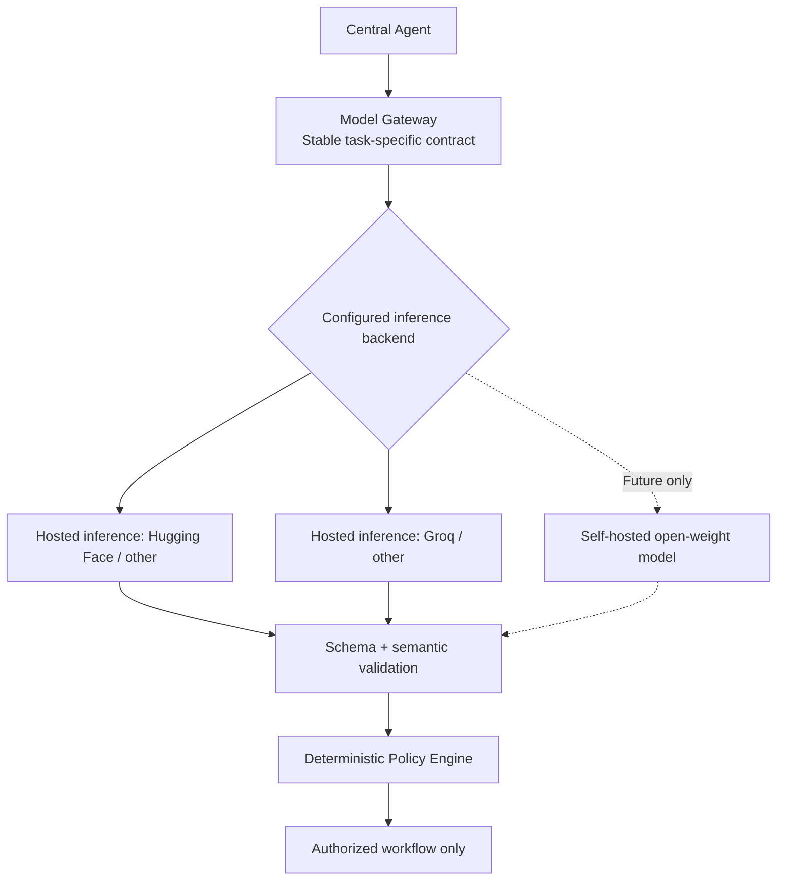

# Cuebik — System Architecture

**Version:** 0.4.1  
**Status:** Working draft — approved direction with open implementation decisions  
**Updated:** 12 October 2026

> **Document scope:** This document records agreed technologies and proposed implementation details. Approved decisions are distinguishable from unresolved vendor, workload, security, and configuration choices. [`PRODUCT.md`](PRODUCT.md) remains authoritative for product behavior. No unimplemented infrastructure or real integrations are represented as operational.

## 1. Technology decisions and open evaluations

The team has approved several technologies and architectural directions. Remaining choices are marked explicitly; **agreement does not substitute for implementation, testing, or security validation**.

| Product responsibility | Selected technology / candidate | Why it fits Cuebik | Decision status |
| --- | --- | --- | --- |
| **Operational database** | PostgreSQL | Transactions and relational integrity for approvals, policies, catalog versions and engagements; enables bank-scoped access enforcement. | **Approved** |
| **Backend language** | Python | Mature ecosystem for financial feature engineering, ranking, evaluation and backend integrations. | **Approved** |
| **Backend framework** | Django + Django Ninja | Data modeling, transactions, existing authentication primitives and typed OpenAPI endpoints suit the transactional core. | **Approved** |
| **Data validation & API contracts** | Validated typed schemas + OpenAPI | Keeps dashboard, PWA and services aligned through versioned runtime-validated contracts. | **Approved direction**; schemas pending |
| **Customer feature processing** | Python; Polars/pandas/NumPy to evaluate | Converts permitted banking summaries into traceable customer features with freshness/uncertainty. | **Python approved**; libraries pending |
| **Recommendation Engine** | Python eligibility rules + explainable ranking | Keeps mandatory restrictions separate from relevance, returns traceable Recommend / Clarify / Suppress outcomes. | **Approved approach**; ML tooling pending |
| **ML tooling** | scikit-learn baseline; LightGBM if useful | Supports repeatable evaluation without claiming that synthetic labels establish real-world quality. | **Candidates** |
| **Central Agent** | Structured Python orchestration + internal Model Gateway | Coordinates whether/when/how with model-independent typed proposals; model never authorizes engagement. | **Approved direction**; framework pending |
| **Policy evaluator** | Versioned deterministic rules | Produces testable Automate / Review / Withhold decisions independent of generated language. | **Approved approach**; rule schema pending |
| **Durable workflows** | Temporal Python SDK, Temporal Cloud intended managed control plane | Persists waiting approvals, timers, retries and worker progress across failures without using HTTP requests as durable state. PostgreSQL remains business authority. | **Approved**; cloud pricing and operations pending |
| **Web frontend** | React + TypeScript (Next.js) | Reusable UI and typed data models across independently deployed web applications. | **Approved** |
| **Web framework** | Next.js + TypeScript | Powers separate deployable marketing, staff dashboard and banking PWA applications with one web ecosystem. | **Approved** |
| **Customer banking demo** | Next.js installable PWA | Demonstrates a fictional bank experience on supported Android browsers without native Android infrastructure; real recommendation state comes from the Core API. | **Approved** |
| **Authentication** | Application-managed using proven Django security primitives | Protects staff access and privileged operations without requiring an identity SaaS at the outset; sessions, MFA and credentials need detailed design. | **Approved approach**; mechanics pending |
| **Hosting & deployment** | Separately deployable application/worker infrastructure + managed PostgreSQL | Allows independent releases/resources while retaining authoritative transactional storage. | **Direction approved**; vendors and regions pending |
| **Observability** | OpenTelemetry-compatible instrumentation | Correlates errors and traces across recommendation, agent, approval, policy and engagement workflows. | **Approved**; backend pending |

### 1.1 Decision boundaries

- **Approved:** The technology/direction is selected; concrete configuration, integration and acceptance tests may still be outstanding.
- **Approved direction:** The architectural approach is agreed, but an implementation library or provider is not yet selected.
- **Candidate:** Must be validated before adoption.

Decisions must be evaluated as a system: Temporal orchestration must coordinate safely with PostgreSQL business state; LLM results must not bypass policy enforcement; the banking PWA must not fabricate engagement delivery.

## 2. Approved application and service boundaries

The product has three independently deployable Next.js web experiences—marketing, staff dashboard and customer banking simulator—and several independently runnable backend responsibilities. **The banking PWA is a virtual smartphone with Banking App, SMS and Email views, rather than three real delivery providers or a native Android application.** Independently deployable applications do not require each business module to become a microservice. Organization-scoped authorizations, product/policy versions, approvals and engagement states require a shared transactional authority.

### 2.1 Editable service diagram

This Mermaid diagram renders natively in GitHub. It represents the proposed functional and deployable boundaries, not deployed infrastructure or real bank integrations.



**Important boundaries:**
- The public website is separate from the authenticated operational dashboard; it does not need customer data access.
- The installable banking PWA portrays a fictional Harbourline Bank customer experience, not a mobile staff dashboard. It requires customer-scoped access; seeded bank data must not replace Core API-backed recommendations and feedback. On desktop, a centered phone shell contains Banking App, SMS, Email and Notifications views; on real mobile screens the simulator uses the mobile viewport without a second phone frame.
- The Core Platform API owns authorized transactional state and applies final authorization. External compute services cannot directly grant approvals or send engagements on their own.
- The Recommendation Service returns structured **Recommend / Clarify / Suppress** decisions and evidence. It does not own approval, policy or delivery records.
- The Agent Worker proposes **whether/when/how**. The Engagement Worker handles scheduled handoffs and feedback, but must revalidate current permissions and policy before external delivery.
- The Model Gateway lives initially within the Agent service and calls hosted inference APIs; future self-hosted inference remains an adapter capability, not an initial deployment. Temporal manages durable workflow progression while Core API + PostgreSQL govern business authorization.
- The diagram is logical: exact protocols, worker infrastructure, network trust boundaries and database topology remain undecided.

### 2.2 Deployment responsibilities and their justification

| Component | Proposed boundary | Why |
| --- | --- | --- |
| **Marketing website** | Independent web application and deployment | Content, SEO, caching and release cadence differ from internal banking operations. |
| **Banking dashboard** | Independent authenticated web application and deployment | Bank staff need rich, secured operations independent of public site releases. |
| **Banking PWA** | Independent installable Next.js web application | Hosts one virtual smartphone with simulated Banking App, SMS, Email, and Notifications views; customer-scoped API supplies only authorized messages and records feedback. |
| **Core Platform API** | Independent backend deployment | Owns authoritative bank-scoped data and consequential policy/approval/engagement transitions. |
| **Intelligence & Recommendation Service** | Independently testable Python service; separate deployment candidate | Feature processing and ML evaluation may require independent resources and model release cycles. |
| **Agent orchestration** | Separate worker runtime; independent deployment if justified | Planning and optional language inference should not block interactive requests. |
| **Engagement execution** | Python Temporal worker, independently runnable | Durable timers, retries, feedback and idempotency with final Core API checks before dispatch. |
| **LLM inference** | Hosted provider initially; self-hosted support future-only | No current GPU/VPS operation; internal gateway keeps provider replacement possible. |
| **Catalog, Customers, Policies and Approvals** | Modules in the Core Platform API initially | Shared transaction, version and authorization requirements make premature decomposition risky. |

**A folder is not automatically a standalone service.** Meaningful independence requires an explicit contract, build/test configuration, well-defined data ownership and operational responsibility. No independent service may use another service's private database tables as an undocumented API.

The Core API must preserve references to input evidence, product versions, policy versions, authorization decisions and status events. A scheduled or retried job must not send a message under stale consent, approval or product terms. Temporal Activity boundaries, outbox/locking, cancellation and idempotency still require detailed design. Temporal does not replace PostgreSQL as the authoritative business record.

### 2.3 Virtual smartphone simulator and Cuebik: end-to-end flow

**Accepted integration concept:** The separately deployed banking PWA and the Cuebik banking dashboard operate against the **same Core API-backed, bank-scoped synthetic dataset and event history**. The PWA is an authorized test source and a simulation of the bank's three permitted customer channels; it is **not** an actual banking core, SMS carrier, external mailbox or official bank mobile application.

The following diagram reproduces the agreed **customer action → Cuebik intelligence → governed engagement → customer inbox → feedback → dashboard** sequence in editable, GitHub-rendered Mermaid. Branching makes explicit that **Clarify**, **Suppress**, **Withhold**, and rejected reviews do not create an outbound message.



The chosen channel is **one branch per authorized engagement**, not a broadcast to all three inboxes. Multiple channels require independent justified and authorized engagements. The simulator must not generate an inbox item for suppressed, withheld, rejected, expired or otherwise unauthorized engagement proposals.

### 2.4 Simulator runtime and contract boundaries

| Boundary | Responsibilities | Reason / invariant |
| --- | --- | --- |
| **PWA UI (apps/web/banking-pwa)** | Desktop centered phone shell; mobile full-viewport UI; simulated Banking App, SMS, Email and Notifications; customer demo interactions. | One installable web app, not an emulated Android OS or three external message services. |
| **Synthetic financial event** | Customer-demo session triggers a permitted fictional savings/deposit/transfer-like action; server validates the scenario and records source, bank/customer scope, event ID, timestamp and provenance. | Reproducible, isolated event inputs for intelligence; no real funds, bank credentials or payment instructions. |
| **Intelligence and agent** | Authorized event data updates appropriate customer features; product matching returns Recommend / Clarify / Suppress; agent proposes a permitted message channel and time. | A synthetic event does not guarantee a product recommendation or contact. |
| **Core policy and approval** | Validate active product/catalog terms, consent and permission, deterministic Automate / Review / Withhold, and exact-message approval where required. | Cuebik remains the authority for contact; the PWA never approves its own engagement. |
| **Temporal and simulation adapter** | Durable scheduled work; final authorization/eligibility recheck; per-channel **simulated** dispatch; idempotent creation of a backend inbox record. | A workflow step or API enqueue alone is not proof that a real message was sent or delivered. |
| **PWA inbox queries** | Fetch customer-scoped simulated items for the selected Banking App, SMS or Email screen; optionally show an in-simulator notification. | The inbox content comes from authoritative backend records, not frontend hardcoded offers. |
| **Feedback API and dashboard** | Record evidenced opens, dismissals, product-detail requests or other supported events against the exact engagement, then display corresponding history in the bank dashboard. | Distinguish queued, simulated sent, simulated delivered/available, viewed and clicked; do not invent customer engagement or real provider delivery. |

**Proposed logical contracts (not finalized HTTP routes or DB schemas):**
1. **SyntheticBankEvent:** demo organization and customer reference; action kind, allowed synthetic balance/transaction change, event ID, occurred-at time, simulator provenance and idempotency key.
2. **SimulatedEngagementDispatch:** engagement reference, authorized channel, approved message/version, expected simulated customer, scheduled time, and unique dispatch/idempotency identity.
3. **SimulatedInboxItem:** channel, simulated recipient, source engagement, displayed body/terms, simulated adapter acknowledgement and timestamps; server-controlled, customer-readable.
4. **CustomerInteractionEvent:** scoped customer-demo identity, source inbox item and engagement, explicit viewed/dismissed/requested-info action, client event identity and server-observed time.

The Core API should authenticate the demo customer session and derive bank/customer access scope server-side, not trust arbitrary identifiers from browser input. Enforce allowed event types and reject mismatched message/engagement/customer references. The exact schemas, transport, refresh strategy, token/session mechanism, storage tables and clock/replay behavior still need specification.

**Status evidence:** A successful mock adapter handoff may justify *simulated Sent*; backend inbox persistence or an explicit simulator acknowledgement may justify *simulated Delivered/Available* only under an agreed evidence contract. A real SMS/email has not been sent, and merely drawing a notification cannot count as a confirmed human view. Production-facing reports must label simulator-derived metrics as synthetic.

**Visual design:** The simulator retains the fictional **Harbourline Bank** identity. Its red-led interface may be inspired by Zenith Bank's color palette, but **no official bank logo, exact proprietary screen recreation, credentials, or claim of real Zenith integration is permitted**. Cuebik's root DESIGN.md governs the marketing site and employee dashboard; the bank simulator's visual system remains separate.

### 2.5 Integration acceptance checks

- A synthetic banking action changes the scoped fictional customer evidence and can trigger a fresh recommendation evaluation, without real money movement or guarantees of a positive recommendation.
- **Recommend + Review** produces no inbox item until an authorized reviewer approves the exact content. Rejection, policy Withhold, and Clarify/Suppress cases yield no contact.
- **Recommend + Automate** may create an authorized item in **exactly the selected simulated channel**, after rechecking current terms and permissions; other inboxes remain unchanged.
- A retry or repeated UI/API event does not duplicate the simulated inbox message; a changed permission or paused product before dispatch blocks it.
- Opening or acting on a simulator message results in a precisely attributed, backend-persisted feedback event visible on the Cuebik dashboard. Only evidence-backed lifecycle states and explicit simulated delivery status are displayed.

## 3. Approved monorepo organization

The **directory organization** is approved; this is the target structure, not a claim that application directories have already been scaffolded. Every deployable app/service is nested under `apps/`, grouped by category.

```text
cuebik/
├── BRAND.md
├── PRODUCT.md
├── ARCHITECTURE.md
├── apps/
│   ├── web/
│   │   ├── DESIGN.md          # Shared Cuebik design rules for marketing/dashboard
│   │   ├── marketing/         # Next.js public website
│   │   ├── dashboard/         # Next.js bank employee portal
│   │   └── banking-pwa/       # Next.js fictional bank PWA
│   └── backend/
│       ├── api/               # Django + Django Ninja authoritative core
│       ├── intelligence/      # Python customer features/recommendations
│       ├── agent/             # Central Agent + Model Gateway
│       └── engagement/        # Python Temporal engagement workers
├── packages/
│   ├── contracts/             # Shared, versioned API schemas and clients
│   └── ui/                    # Shared Cuebik web UI where applicable
├── infra/                     # Deployment configuration and Temporal environment
└── assets/
    └── brand/                 # Shared approved brand assets
```

**Document-location note:** The existing root-level `DESIGN.md` has **not yet moved**. It currently governs the Cuebik landing site and bank dashboard. When app folders are physically created, move it to `apps/web/DESIGN.md` and update all links together. It does not govern the fictional bank PWA's visual identity.

Applications retain independent builds and deployments. Core modules share authorized state; separate services use documented contracts. No `services/` or `infrastructure/` top-level directory is planned, and no initial GPU/model-server application directory is required.

## 4. Intelligence and execution design rules

The selected backend language and framework are recorded in [`1](#1-technology-decisions-and-open-evaluations); deployable ownership is defined in [`2](#2-approved-application-and-service-boundaries). The following rules specify **how the distinct Python workloads cooperate**, without repeating the technology matrix.

- **Customer Intelligence and Recommendation Engine (`apps/backend/intelligence`):** Transform permitted bank-scoped signals into evidence with provenance and freshness, check active catalog eligibility **before** relevance scoring, and return structured **Recommend / Clarify / Suppress** outcomes with evaluation and product versions. An explainable baseline comes first; learned ranking requires representative labels and measured improvement. A synthetic dataset does not prove real-world model performance.
- **Central Agent (`apps/backend/agent`):** Consume an authorized recommendation result, propose whether, when, and how to engage, and return a validated, explainable proposal through the Core API. Optional language-model calls go **only through the Model Gateway**; no LLM output is approval or dispatch permission.
- **Policy and transactional core (`apps/backend/api`):** Evaluate versioned bank restrictions deterministically (**Automate / Review / Withhold**), maintain authoritative approvals and engagement state, and reject unauthorized transitions. External intelligence and agent services cannot modify protected state directly.
- **Durable execution (`apps/backend/engagement` with Temporal):** Activities perform I/O, scheduled operations and channel handoffs after a final Core API authorization check. Temporal tracks workflow progress; PostgreSQL remains the business source of truth. Retries and external side effects require explicit idempotency and evidence-based status updates.

Training tools, agent libraries, precise internal protocols and state coordination are implementation decisions, not additional approved stack dependencies.

## 5. Model Gateway and provider portability

**Approved approach:** The Central Agent communicates through its internal Model Gateway with **hosted model APIs initially**. Support self-hosted open-weight models in the gateway contract for a later phase, but do not provision GPU/VPS model-serving infrastructure now. gpt-oss and Qwen are evaluation candidates; no specific production provider or failover path has passed acceptance testing.



### 5.1 What the gateway owns

- **Provider routing:** Select model/provider/revision and endpoint from protected configuration; do not hardcode vendor calls in agent business logic.
- **Stable contracts:** Accept permitted context/allowed actions and return a typed, structured proposal rather than executable permission.
- **Validation:** Check response schema and business semantics; reject invented rates, unsourced claims, disallowed channels, unsupported evidence references and invalid action types.
- **Reliability:** Normalize timeouts, failures, rate limits and bounded retries. A failed model call must not authorize engagement.
- **Traceability:** Record model/provider/prompt versions, request IDs and evaluation metadata without logging sensitive customer content unnecessarily.
- **Migration safety:** Test a replacement on the same Cuebik-specific task suite before activating it; API compatibility alone does not guarantee equivalent output or tool calling.

A gateway can be an internal agent module initially. Independent deployment becomes a separate operational decision. The LLM may propose content or action; the Policy Engine remains the authority for **Automate / Review / Withhold**, and the Core API validates the final dispatch state.

### 5.2 Where Hugging Face fits

Hugging Face is **a model discovery, distribution and inference platform**, not one mandatory model that Cuebik must use.

| Hugging Face capability | How Cuebik could use it | Important qualification |
| --- | --- | --- |
| **Model Hub** | Discover, evaluate and download open-weight models; inspect licenses, model cards and pinned revisions. | Licenses, gated access, suitability and model-code risks differ by model. |
| **Inference Providers** | Evaluate hosted models with a common Python/HTTP interface without first operating GPUs. | Requests are routed via Hugging Face and real inference providers; review privacy, geography, billing and provider-specific behaviour. |
| **Dedicated Inference Endpoints** | Deploy an approved model through managed compute with selected hardware and scaling. | Dedicated managed inference is still third-party hosting; region and network security require review. |
| **Self-hosted downloaded models** | Serve licensed weights using a chosen runtime such as vLLM where supported. | Requires compute, monitoring, secure serving, licensing checks and model version management. |

Relevant official references:
- Hugging Face Model Cards: https://huggingface.co/docs/hub/model-cards
- Hugging Face Gated Models: https://huggingface.co/docs/hub/models-gated
- Hugging Face Inference Providers: https://huggingface.co/docs/inference-providers/index
- Hugging Face Inference Endpoints: https://huggingface.co/docs/inference-endpoints/about
- Hugging Face Endpoint security: https://huggingface.co/docs/inference-endpoints/security
- vLLM compatible API/security: https://docs.vllm.ai/en/latest/serving/online_serving/openai_compatible_server/

**Decision state:** Hosted inference is approved initially, with gpt-oss and Qwen as evaluation candidates. Hugging Face remains an optional model discovery/inference platform. Actual provider, pricing, privacy terms, model/version and failover still need validation; self-hosting is deferred.

### 5.3 Model and customer-data safeguards

External inference changes where bank-derived data is processed. Apply data minimization; avoid raw credentials, full banking histories or sensitive identifiers for message drafting; assess actual service contracts, retention, routing, residency and access controls before using real data. Self-hosted inference still requires model provenance, dependency and runtime security reviews. Invalid/unavailable model output fails safely, without assuming permission.

## 6. Implementation decisions still open

The **approved technologies and their reasons** are maintained in [`1](#1-technology-decisions-and-open-evaluations); no additional stack is implied by these unresolved tasks. Contributors must not present pending choices or unimplemented integrations as operational.

1. **Workflow reliability:** Define Temporal Workflow/Activity boundaries, human approval signals, cancellation, timeout/retry policies, idempotency, transactional outbox/reconciliation and the pre-dispatch authorization boundary. Validate Temporal Cloud region, retention, pricing and separately hosted Python workers.
2. **Simulator contracts:** Finalize the bank-scoped synthetic event schema, demo-customer authentication, approved inbox records, per-channel acknowledgements, feedback provenance and duplicate-event handling. Acceptance scenarios are specified in [`2.5](#25-integration-acceptance-checks).
3. **Intelligence and agent evaluation:** Choose the feature-processing and ranking baseline; evaluate evidence quality and candidate ML tooling. Test gpt-oss and Qwen via hosted providers using Cuebik-specific accuracy, schema, latency, privacy and cost criteria before selecting active models and fallback behavior.
4. **Authentication and service boundaries:** Specify employee sessions, credentials, authorization roles and MFA needs; define versioned inter-service contracts, tenant isolation, data ownership and audit records.
5. **Infrastructure and operations:** Select hosting/regions for Next.js apps, Core API, intelligence and workers, plus managed PostgreSQL. Specify secrets, backups, tracing storage, recovery procedures, operational alerts and measurable service objectives.

**Repository migration is deferred to scaffolding:** The existing root-level `DESIGN.md` remains authoritative until it and its relative references can move together to `apps/web/DESIGN.md`, as recorded in [`3](#3-approved-monorepo-organization).
