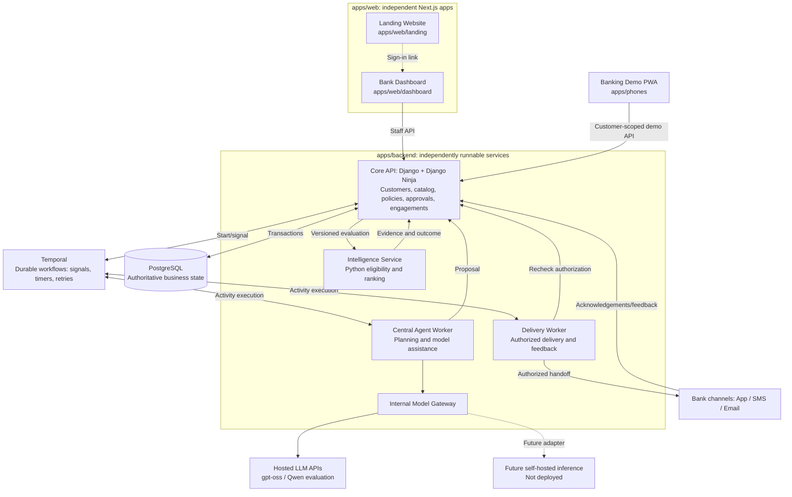
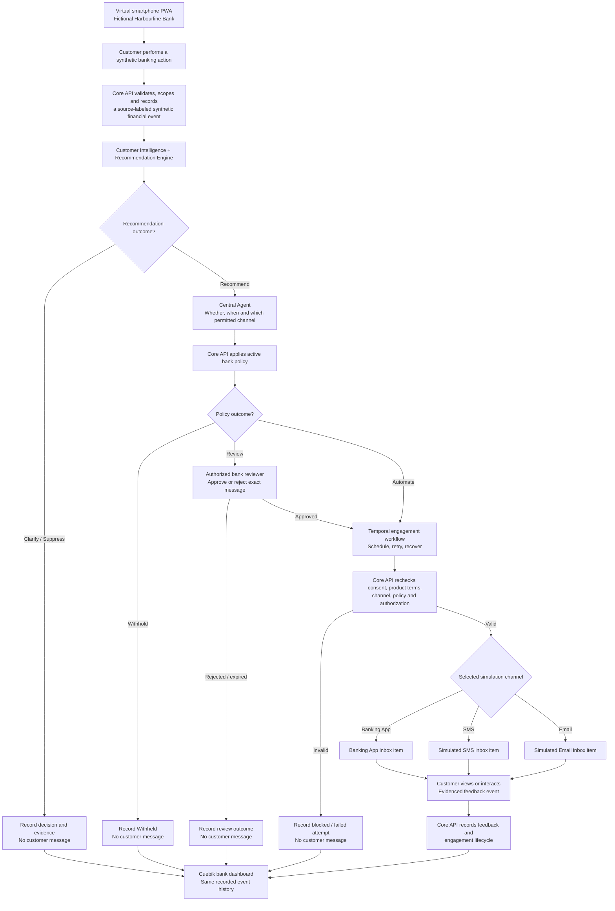
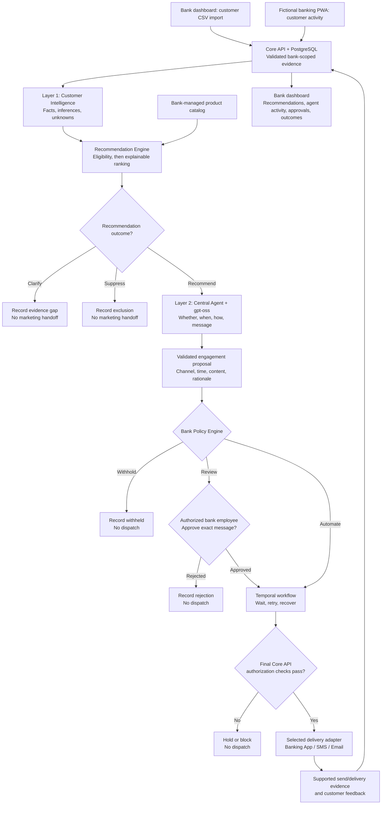
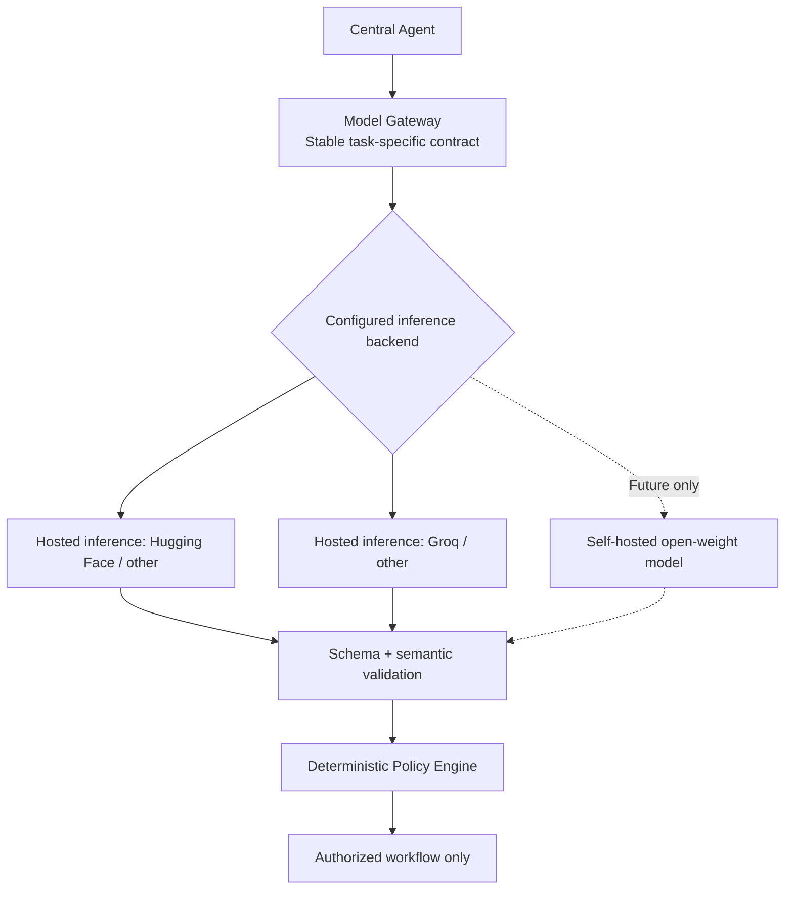

# Cuebik — System Architecture

**Version:** 0.4.14  
**Status:** Working draft — approved direction with open implementation decisions  
**Updated:** 13 October 2026

> **Document scope:** This document records agreed technologies and proposed implementation details. Approved decisions are distinguishable from unresolved vendor, workload, security, and configuration choices. [`PRODUCT.md`](PRODUCT.md) remains authoritative for product behavior. No unimplemented infrastructure or real integrations are represented as operational.

## 1. Technology decisions and open evaluations

The team has approved several technologies and architectural directions. Remaining choices are marked explicitly; **agreement does not substitute for implementation, testing, or security validation**.

| Product responsibility | Selected technology / candidate | Why it fits Cuebik | Decision status |
| --- | --- | --- | --- |
| **Operational database** | PostgreSQL | Transactions and relational integrity for approvals, policies, catalog versions and engagements; enables bank-scoped access enforcement. | **Approved** |
| **Backend language** | Python | Mature ecosystem for financial feature engineering, ranking, evaluation and backend integrations. | **Approved** |
| **Backend framework** | Django + Django Ninja | Data modeling, transactions, existing authentication primitives and typed OpenAPI endpoints suit the transactional core. | **Approved** |
| **Data validation & API contracts** | Validated typed schemas + OpenAPI | Keeps dashboard, PWA and services aligned through versioned runtime-validated contracts. | **Approved direction**; schemas pending |
| **Customer feature processing** | Python; Polars/pandas/NumPy to evaluate | Converts permitted banking summaries into traceable customer features with freshness/uncertainty. | **Python approved**; libraries pending |
| **Recommendation Engine** | Python eligibility rules + explainable ranking | Keeps mandatory restrictions separate from relevance, returns traceable Recommend / Clarify / Suppress outcomes. | **Approved approach**; ML tooling pending |
| **ML tooling** | scikit-learn baseline; LightGBM if useful | Supports repeatable evaluation without claiming that synthetic labels establish real-world quality. | **Candidates** |
| **Central Agent** | Structured Python orchestration + internal Model Gateway | Coordinates whether/when/how with model-independent typed proposals; model never authorizes engagement. | **Approved direction**; orchestration details pending |
| **Initial LLM family** | gpt-oss through hosted inference | Bounded Central Agent proposal and language tasks; Qwen is an optional alternative, not a mandatory second model. | **gpt-oss selected**; exact model, provider and evaluation pending |
| **Policy evaluator** | Versioned deterministic rules | Produces testable Automate / Review / Withhold decisions independent of generated language. | **Approved approach**; rule schema pending |
| **Durable workflows** | Temporal Python SDK, Temporal Cloud intended managed control plane | Persists waiting approvals, timers, retries and worker progress across failures without using HTTP requests as durable state. PostgreSQL remains business authority. | **Approved**; cloud pricing and operations pending |
| **Outbound provider integrations** | [Africa's Talking](https://africastalking.com/) for SMS; [SendByte](https://sendbyte.africa/) for Email | Replaceable adapters for **bank-controlled SMS/Email channels**, using bank-configured provider accounts or authorized existing bank delivery gateways; the simulator continues to use mock inbox adapters. No default Cuebik-owned bulk sending. | **Initial providers selected**; integrations and production suitability unverified |
| **Web frontend** | React + TypeScript (Next.js) | Reusable UI and typed data models across independently deployed web applications. | **Approved** |
| **Web framework** | Next.js + TypeScript | Powers separate deployable marketing, staff dashboard and banking PWA applications with one web ecosystem. | **Approved** |
| **Customer banking demo** | Next.js installable PWA | Demonstrates a fictional bank experience on supported Android browsers without native Android infrastructure; real recommendation state comes from the Core API. | **Approved** |
| **Authentication** | Application-managed using proven Django security primitives | Protects staff access and privileged operations without requiring an identity SaaS at the outset; sessions, MFA and credentials need detailed design. | **Approved approach**; mechanics pending |
| **Hosting & deployment** | Separately deployable application/worker infrastructure + managed PostgreSQL | Allows independent releases/resources while retaining authoritative transactional storage. | **Direction approved**; vendors and regions pending |
| **Observability** | OpenTelemetry-compatible instrumentation | Correlates errors and traces across recommendation, agent, approval, policy and engagement workflows. | **Approved**; backend pending |

### 1.1 Decision boundaries

- **Approved:** The technology/direction is selected; concrete configuration, integration and acceptance tests may still be outstanding.
- **Approved direction:** The architectural approach is agreed, but an implementation library or provider is not yet selected.
- **Candidate:** Must be validated before adoption.

Decisions must be evaluated as a system: Temporal orchestration must coordinate safely with PostgreSQL business state; LLM results must not bypass policy enforcement; the banking PWA must not fabricate engagement delivery.

## 2. Approved application and service boundaries

The product has three independently deployable Next.js web applications—the public landing site, staff dashboard and fictional banking PWA—and several independently runnable backend responsibilities. The landing site (`apps/web/landing`) and dashboard (`apps/web/dashboard`) are **separate application roots** within the `apps/web` organizational grouping; the virtual-phone banking simulator (`apps/phones`) is a separate top-level, independently buildable and deployable app. **The banking PWA is a virtual smartphone with Banking App, SMS and Email views, rather than three real delivery providers or a native Android application.** Independently deployable applications do not require each business module to become a microservice. Organization-scoped authorizations, product/policy versions, approvals and engagement states require a shared transactional authority.

### 2.1 Editable service diagram

This Mermaid diagram renders natively in GitHub. It represents the proposed functional and deployable boundaries, not deployed infrastructure or real bank integrations.



**Important boundaries:**
- The public landing website and authenticated operational dashboard are **separately built, tested and deployable apps**; the landing site does not need customer data access. Neither frontend requires building or deploying backend source code as part of its own release; runtime API integrations remain explicit.
- **The Cuebik dashboard and backend are real, working product functionality to build**, not mock screens: bank staff create and maintain product catalog records, inspect customer intelligence and recommendation evidence, manage bank policies, review exact messages, and track genuine system state persisted by the Core API in PostgreSQL. Initial banking data is synthetic; dashboard interactions and processing are not fabricated.
- The installable banking PWA portrays a fictional Harbourline Bank customer experience, not a mobile staff dashboard. It requires customer-scoped access; seeded bank data must not replace Core API-backed recommendations and feedback. On desktop, a centered phone shell contains Banking App, SMS, Email and Notifications views; on real mobile screens the simulator uses the mobile viewport without a second phone frame.
- The Core Platform API owns authorized transactional state and applies final authorization. External compute services cannot directly grant approvals or send engagements on their own.
- The Recommendation Service returns structured **Recommend / Clarify / Suppress** decisions and evidence. It does not own approval, policy or delivery records.
- The Agent Worker proposes **whether/when/how**. The Delivery Worker handles scheduled handoffs and feedback, but must revalidate current permissions and policy before external delivery.
- The Model Gateway lives initially within the Agent service and calls hosted inference APIs; future self-hosted inference remains an adapter capability, not an initial deployment. Temporal manages durable workflow progression while Core API + PostgreSQL govern business authorization.
- The diagram is logical: exact protocols, worker infrastructure, network trust boundaries and database topology remain undecided.

### 2.2 Deployment responsibilities and their justification

| Component | Proposed boundary | Why |
| --- | --- | --- |
| **Landing website (`apps/web/landing`)** | Own independent Next.js project, build and deployment | Public content, SEO, caching and release cadence differ from the staff dashboard and banking simulator. |
| **Banking dashboard (`apps/web/dashboard`)** | Own independent authenticated Next.js project, build and deployment | Bank staff need rich, secured operations independent of public site releases. |
| **Banking PWA (`apps/phones`)** | Own top-level independent installable Next.js project, build and deployment | Hosts one virtual smartphone with simulated Banking App, SMS, Email, and Notifications views; customer-scoped API supplies only authorized messages and records feedback. |
| **Core Platform API** | Independent backend deployment | Owns authoritative bank-scoped data and consequential policy/approval/engagement transitions. |
| **Intelligence & Recommendation Service** | Independently testable Python service; separate deployment candidate | Feature processing and ML evaluation may require independent resources and model release cycles. |
| **Agent orchestration** | Separate worker runtime; independent deployment if justified | Planning and optional language inference should not block interactive requests. |
| **Delivery execution** | Python Temporal worker, independently runnable | Executes authorized engagement dispatch, timers, retries, feedback and idempotency with final Core API checks. |
| **LLM inference** | Hosted provider initially; self-hosted support future-only | No current GPU/VPS operation; internal gateway keeps provider replacement possible. |
| **Catalog, Customers, Policies and Approvals** | Modules in the Core Platform API initially | Shared transaction, version and authorization requirements make premature decomposition risky. |

**A folder is not automatically a standalone service.** Meaningful independence requires an explicit contract, build/test configuration, well-defined data ownership and operational responsibility. No independent service may use another service's private database tables as an undocumented API.

The Core API must preserve references to input evidence, product versions, policy versions, authorization decisions and status events. A scheduled or retried job must not send a message under stale consent, approval or product terms. Temporal Activity boundaries, outbox/locking, cancellation and idempotency still require detailed design. Temporal does not replace PostgreSQL as the authoritative business record.

### 2.3 Virtual smartphone simulator and Cuebik: end-to-end flow

**Accepted integration concept:** The separately deployed banking PWA and the Cuebik banking dashboard operate against the **same Core API-backed, bank-scoped synthetic dataset and event history**. The PWA is an authorized test source and a simulation of the bank's three permitted customer channels; it is **not** an actual banking core, SMS carrier, external mailbox or official bank mobile application.

The following diagram reproduces the agreed **customer action → Cuebik intelligence → governed engagement → customer inbox → feedback → dashboard** sequence in editable, GitHub-rendered Mermaid. Branching makes explicit that **Clarify**, **Suppress**, **Withhold**, and rejected reviews do not create an outbound message.



The chosen channel is **one branch per authorized engagement**, not a broadcast to all three inboxes. Multiple channels require independent justified and authorized engagements. The simulator must not generate an inbox item for suppressed, withheld, rejected, expired or otherwise unauthorized engagement proposals.

### 2.4 Simulator runtime and contract boundaries

| Boundary | Responsibilities | Reason / invariant |
| --- | --- | --- |
| **PWA UI (apps/phones)** | Desktop centered phone shell; mobile full-viewport UI; simulated Banking App, SMS, Email and Notifications; customer demo interactions. | One installable web app, not an emulated Android OS or three external message services. |
| **Synthetic financial event** | Customer-demo session triggers a permitted fictional savings/deposit/transfer-like action; server validates the scenario and records source, bank/customer scope, event ID, timestamp and provenance. | Reproducible, isolated event inputs for intelligence; no real funds, bank credentials or payment instructions. |
| **Observed app activity** | Record permitted, attributable app-open and customer interaction events with timestamps and provenance for engagement-timing context. | Bank-app activity does not establish general internet presence or permission to market. |
| **Intelligence and agent** | Authorized event data updates appropriate customer features; product matching returns Recommend / Clarify / Suppress; agent proposes a permitted message channel and time. | A synthetic event does not guarantee a product recommendation or contact. |
| **Core policy and approval** | Validate active product/catalog terms, consent and permission, deterministic Automate / Review / Withhold, and exact-message approval where required. | Cuebik remains the authority for contact; the PWA never approves its own engagement. |
| **Temporal and simulation adapter** | Durable scheduled work; final authorization/eligibility recheck; per-channel **simulated** dispatch; idempotent creation of a backend inbox record. | A workflow step or API enqueue alone is not proof that a real message was sent or delivered. |
| **PWA inbox queries** | Fetch customer-scoped simulated items for the selected Banking App, SMS or Email screen; optionally show an in-simulator notification. | The inbox content comes from authoritative backend records, not frontend hardcoded offers. |
| **Feedback API and dashboard** | Record evidenced opens, dismissals, product-detail requests or other supported events against the exact engagement, then display corresponding history in the bank dashboard. | Distinguish queued, simulated sent, simulated delivered/available, viewed and clicked; do not invent customer engagement or real provider delivery. |

**Proposed logical contracts (not finalized HTTP routes or DB schemas):**
1. **SyntheticBankEvent:** demo organization and customer reference; action kind, allowed synthetic balance/transaction change, event ID, occurred-at time, simulator provenance and idempotency key.
2. **SimulatedEngagementDispatch:** engagement reference, authorized channel, approved message/version, expected simulated customer, scheduled time, and unique dispatch/idempotency identity.
3. **SimulatedInboxItem:** channel, simulated recipient, source engagement, displayed body/terms, simulated adapter acknowledgement and timestamps; server-controlled, customer-readable.
4. **CustomerInteractionEvent:** scoped customer-demo identity, source inbox item and engagement, explicit viewed/dismissed/requested-info action, client event identity and server-observed time.
5. **BankAppActivityEvent:** bank/customer-scoped permitted app-open or interaction type, observed time, source/provenance and unique event identity; last-observed activity is derived from evidence, not assumed live internet presence.

The Core API should authenticate the demo customer session and derive bank/customer access scope server-side, not trust arbitrary identifiers from browser input. Enforce allowed event types and reject mismatched message/engagement/customer references. The exact schemas, transport, refresh strategy, token/session mechanism, storage tables and clock/replay behavior still need specification.

**Status evidence:** A successful mock adapter handoff may justify *simulated Sent*; backend inbox persistence or an explicit simulator acknowledgement may justify *simulated Delivered/Available* only under an agreed evidence contract. A real SMS/email has not been sent, and merely drawing a notification cannot count as a confirmed human view. Production-facing reports must label simulator-derived metrics as synthetic.

**Visual design:** The simulator retains the fictional **Harbourline Bank** identity. Its red-led interface may be inspired by Zenith Bank's color palette, but **no official bank logo, exact proprietary screen recreation, credentials, or claim of real Zenith integration is permitted**. Cuebik's `apps/web/DESIGN.md` governs the marketing site and employee dashboard; the bank simulator's visual system remains separate.

### 2.5 Integration acceptance checks

- A synthetic banking action changes the scoped fictional customer evidence and can trigger a fresh recommendation evaluation, without real money movement or guarantees of a positive recommendation.
- **Recommend + Review** produces no inbox item until an authorized reviewer approves the exact content. Rejection, policy Withhold, and Clarify/Suppress cases yield no contact.
- **Recommend + Automate** may create an authorized item in **exactly the selected simulated channel**, after rechecking current terms and permissions; other inboxes remain unchanged.
- A retry or repeated UI/API event does not duplicate the simulated inbox message; a changed permission or paused product before dispatch blocks it.
- Opening or acting on a simulator message results in a precisely attributed, backend-persisted feedback event visible on the Cuebik dashboard. Only evidence-backed lifecycle states and explicit simulated delivery status are displayed.
- **CSV-only delivery acceptance:** Every validated CSV customer can be evaluated and appear in the bank dashboard without a simulator account. If that customer has **no linked authorized simulator recipient**, the simulated adapter produces no inbox item or fictitious Sent/Delivered status; the real recommendation and agent proposal records remain visible. If a recipient is properly linked and the engagement passes current policy/approval checks, only the selected simulated channel may receive the message.

### 2.6 Provider-agnostic external integrations

**Approved principle:** Cuebik's business logic must be independent of external service vendors. Recommendation eligibility, Central Agent proposals, policy decisions, approvals, Temporal workflows and customer-facing event history use **Cuebik-owned integration contracts**, while **customer outreach remains under the bank's delivery authority** as required in [`PRODUCT.md`](PRODUCT.md#4-end-to-end-product-journey) and [§5.1](PRODUCT.md#51-bank-integrations). Vendor SDK calls and provider-specific fields belong in replaceable adapters; changing a provider must not require rewriting authorization rules or customer journeys. **Naming Africa's Talking and SendByte as initial adapter providers does not authorize a Cuebik-owned sender account or a separate Cuebik-operated marketing channel.**

| Channel | Selected initial external provider | Status |
| --- | --- | --- |
| **SMS** | [Africa's Talking](https://africastalking.com/) | Selected adapter for a bank-configured SMS provider account or an authorized bank delivery gateway; sender/account ownership, sending capability, regional coverage, pricing and callbacks require validation. |
| **Email** | [SendByte](https://sendbyte.africa/) | Selected adapter for a bank-configured email provider account or an authorized bank delivery gateway; sender/domain verification, API compatibility, pricing and callbacks require validation. |
| **Banking App** | Bank-owned integration in a future real deployment; simulator-owned in-app inbox initially | No external bank integration is implemented or authorized. |

**Delivery contract:** The Core API owns engagement identifiers, tenant/customer scope, chosen channel, approved message version, permissions and state transitions. A channel adapter acts only on an explicitly configured **bank-controlled delivery connection** (the bank's authorized provider account/credentials or an existing bank-managed gateway) and returns a normalized handoff outcome; authenticated provider callbacks contribute distinct sending, delivery or failure evidence when genuinely supported. Cuebik may integrate the adapter, but it must not silently substitute its own sender identity, provider account or customer-contact authority. Provider message IDs, protected connection credentials, payload conventions and error codes remain behind the adapter. Retries require idempotency/reconciliation, and provider acknowledgements must not be promoted to confirmed delivery without supporting evidence.

**Permission boundary:** The bank supplies existing customer contact details and applicable channel- and purpose-specific permissions or restrictions through its data/connector boundary. Cuebik does not require customers to create accounts or select contact preferences separately in Cuebik. Transactional alerts do not automatically establish permission for promotional recommendations; unknown or prohibited promotional contact stays blocked. Bank communication authority and bank-internal approval of an individual proposal are separate checks.

**Simulation versus real delivery:** The virtual phone uses simulated Banking App, SMS and Email adapters backed by persistent test records. Simulation is the default demo behavior; it must never send real SMS/email or claim a carrier/mailbox delivery. Real-provider routing requires an **explicitly configured and authorized bank-controlled delivery connection and sender identity**, validated destination, and final pre-dispatch policy checks. Absent that connection, real sending is unavailable—not automatically rerouted through a Cuebik-owned account.

**Portability scope:** The Model Gateway already isolates hosted LLM providers. Apply the same vendor-boundary principle to hosting, storage and observability integrations where a substitutable external provider exists, without implying that swapping vendors is automatic or free. **Django + Django Ninja, PostgreSQL and Temporal remain selected technologies**, not pending choices to replace for the sake of abstract portability.

**Acceptance criterion:** Each channel supports a contract-testable mock implementation and a provider adapter that produces the same normalized business states. Switching the configured provider must not bypass consent, policy, approval, message-version checks or duplicate-dispatch protection.

### 2.7 Functional platform versus synthetic banking inputs

**First-release requirement:** Cuebik's bank-facing dashboard, product catalog, Core API, customer-intelligence processing, recommendation evaluation, Central Agent coordination, bank-policy enforcement, approval workflow, Temporal execution, and audit/feedback history must **function end to end against authoritative backend records**. The fictional banking environment supplies permitted **synthetic customer/account/activity data**, and the virtual phone provides **simulated customer delivery views**. Do not substitute UI-only recommendations, fake dashboard totals, fixed agent outputs, or animated message delivery for actual application behavior.

**Input boundary:** The first implementation supports **CSV uploads of fictional customer data** through the bank-facing dashboard **and synthetic customer activity from the banking simulator**. Both must use validated, bank-scoped ingestion into the same authoritative customer-intelligence pipeline, recording import results and data provenance. Bank employees must be able to create and manage real product-catalog records in the dashboard. Real bank feeds and real money movement are not part of this initial demonstration. The precise CSV columns, mapping, error handling and import workflow are implementation details.

**Approved identity-and-delivery boundary:** The Core API associates customer data, recommendations, agent decisions and simulated inbox messages with an authoritative **bank-scoped customer reference**. It must not infer that a CSV record has a simulator recipient merely because it was imported or has a similar name. **Unlinked CSV-only records remain fully analyzable and visible on the bank dashboard**, but they do not produce a virtual Banking App, SMS or Email delivery. The selected simulated adapter can dispatch only to an explicitly matched, authorized simulator recipient following active policy and any required approval. An independently configured real SMS/email provider, if later enabled, requires its own verified destination and actual delivery evidence. **No simulated recipient ≠ no customer intelligence; no delivery evidence ≠ Delivered.**

**Approved timing inputs; trigger mechanics pending:** Recorded and permitted bank-app opens/interactions, last-observed activity, customer engagement history and bank contact windows may inform the Central Agent's proposed time and its evidence-based rationale. These signals are not global online-presence tracking or proof of an optimal send time; missing signals do not imply inactivity. On permitted changes to customer data or catalog terms, **event-driven evaluation is the proposed initial trigger**, with optional scheduled re-evaluation at a configured cadence; the exact trigger mechanics remain implementation choices. **Only a qualifying Recommend outcome** can initiate engagement planning; Clarify and Suppress do not create a marketing handoff. Bank policy and, where required, human review authorize a proposed channel, content and timing. Temporal coordinates an authorized wait and pre-dispatch checks; no continuously running LLM loop is required.

**Customer Intelligence is a data-processing capability, not inherently a graph database.** It preserves observed facts, qualified inferences, unknowns and evidence links. A dashboard evidence/relationship graph could visualize those records, but an interactive knowledge graph and separate graph database have **not** been selected as first-release requirements.

## 3. Approved monorepo organization

The **directory organization** is approved and has been scaffolded with tracked directory placeholders. This layout does **not** mean the applications, backend services, shared packages or infrastructure have been implemented. Every deployable app/service lives under `apps/`: the independent landing and staff dashboard apps are grouped in `apps/web/`, while the fictional virtual-phone PWA has its own top-level `apps/phones/` directory. The plural folder name labels a **single standalone simulation application**, not separate SMS, Email or Banking App deployments.

```text
cuebik/
├── BRAND.md
├── PRODUCT.md
├── ARCHITECTURE.md
├── apps/
│   ├── web/
│   │   ├── DESIGN.md          # Shared Cuebik design rules for marketing/dashboard
│   │   ├── landing/           # Independent Next.js public landing site
│   │   └── dashboard/         # Independent Next.js bank employee portal
│   ├── phones/                # Standalone Next.js virtual-phone bank simulator
│   └── backend/
│       ├── api/               # Django + Django Ninja authoritative core
│       ├── intelligence/      # Python customer features/recommendations
│       ├── agent/             # Central Agent + Model Gateway
│       └── delivery/          # Python Temporal delivery workers
├── packages/
│   ├── contracts/             # Shared, versioned API schemas and clients
│   └── ui/                    # Optional Cuebik landing/dashboard UI only; not phones
├── infra/                     # Deployment configuration and Temporal environment
└── assets/
    └── brand/                 # Shared approved brand assets
```

**Document-location note:** The existing design guide was relocated from the repository root to [`apps/web/DESIGN.md`](apps/web/DESIGN.md) during directory scaffolding. It continues to govern Cuebik's marketing site and bank dashboard, **not** the fictional bank PWA's visual identity.

**Frontend component ownership:** `packages/ui/` is reserved for **optional reusable Cuebik-branded UI primitives** that `apps/web/landing/` and `apps/web/dashboard/` may deliberately consume. It does not contain a combined app shell. The **dashboard sidebar, top navigation, layouts and domain-specific screen components belong to `apps/web/dashboard/`** and can be reused across its routes; the landing application owns its own page shell. **`apps/phones/` must not import `packages/ui/`, `apps/web/` components, or Cuebik dashboard/landing styling.** Phones has its own internal components and bank-specific visual system, while integrating with backend APIs through explicit versioned contracts. These are dependency boundaries; each application remains independently buildable and deployable.

`apps/web/` is **a grouping directory, not one combined frontend build**. When implementation begins, `apps/web/landing/`, `apps/web/dashboard/` and `apps/phones/` each own their app source, application manifest, build configuration, tests and deployment target. A contributor may work on, build and deploy the landing app without rebuilding the dashboard, PWA or backend; likewise, the dashboard and PWA release independently. An app may deliberately consume versioned shared packages or APIs, whose contract changes can affect consumers; independence does not mean zero shared dependencies. No app scaffolding/configuration exists yet. Core modules share authorized state; separate services use documented contracts. No `services/` or `infrastructure/` top-level directory is planned, and no initial GPU/model-server application directory is required.

## 4. Intelligence and execution design rules

The selected backend language and framework are recorded in [§1](#1-technology-decisions-and-open-evaluations); deployable ownership is defined in [§2](#2-approved-application-and-service-boundaries). The following rules specify **how the distinct Python workloads cooperate**, without repeating the technology matrix.

- **Customer Intelligence and Recommendation Engine (`apps/backend/intelligence`):** Transform permitted bank-scoped signals into evidence with provenance and freshness, check active catalog eligibility **before** relevance scoring, and return structured **Recommend / Clarify / Suppress** outcomes with evaluation and product versions. The **first release uses Python deterministic eligibility and explainable feature-based relevance ranking**; learning-based rankers are later evaluation candidates, not initial dependencies. A synthetic dataset does not prove real-world model performance.
- **Central Agent (`apps/backend/agent`):** Consume a qualifying recommendation result and permitted bank-app activity/engagement evidence, then propose whether, when, and how to engage through a validated, explainable Core API record. The selected **gpt-oss** model can assist with bounded proposal reasoning and message drafting through the Model Gateway; the **Recommendation Engine handles product eligibility/ranking separately**, and Temporal handles authorized scheduling. No LLM output is approval or dispatch permission.
- **Policy and transactional core (`apps/backend/api`):** Evaluate versioned bank restrictions deterministically (**Automate / Review / Withhold**), maintain authoritative approvals and engagement state, and reject unauthorized transitions. External intelligence and agent services cannot modify protected state directly.
- **Delivery execution (`apps/backend/delivery` with Temporal):** Activities perform I/O, scheduled operations and channel handoffs after a final Core API authorization check. Temporal tracks workflow progress; PostgreSQL remains the business source of truth. Retries and external side effects require explicit idempotency and evidence-based status updates. The directory is named for its service responsibility; individual Temporal worker implementations will live inside it.

Training tools, agent libraries, precise internal protocols and state coordination are implementation decisions, not additional approved stack dependencies.

### 4.1 Simple mental model: from customer insight to engagement

**Cuebik has two intelligence layers, followed by bank-controlled authorization and execution.** This is a responsibility map—not five separately deployed services.

| Responsibility | The question it answers | What it does |
| --- | --- | --- |
| **Layer 1 — Customer Intelligence** | **What do we know about the customer?** | Organizes permitted banking facts, qualified inferences, unknowns, source evidence and freshness. |
| **Layer 1 — Recommendation Engine** | **What relevant, eligible product could fit?** | Applies bank-defined eligibility first, then explainable ranking; returns **Recommend / Clarify / Suppress**. |
| **Layer 2 — Central Agent + gpt-oss** | **Should we propose engagement, when, and how?** | Coordinates an eligible recommendation; uses the selected gpt-oss model through the Model Gateway for bounded proposal reasoning, explanations and message drafting, with validated outputs. |
| **Bank Policy & Approvals** | **Is this proposed engagement permitted?** | Enforces **Automate / Review / Withhold**, existing bank-managed communication restrictions and human approval where required. |
| **Temporal + channel adapters** | **How is an authorized communication executed and tracked?** | Waits, retries and rechecks authorization before the selected Banking App, SMS or Email handoff; records supported outcomes and feedback. |

**Remember:** *Customer Intelligence understands the customer. The Recommendation Engine finds the product. The Central Agent plans the engagement. Bank Policy decides what is permitted. Temporal and channel adapters execute and track the authorized communication.*

**Model boundary:** Layer 1 **does not require a language model** to function: Python feature processing, deterministic eligibility and explainable ranking form the initial baseline (any later learned ranking is a separate evaluated choice). Layer 2 **uses gpt-oss as its selected language-model component** for bounded engagement-planning tasks; the Central Agent is still Python-controlled orchestration, not a model with independent authority. An unavailable or invalid model result cannot authorize contact. The agent proposes a suitable, evidence-supported contact time—not a proven optimal send time. The same model may support multiple agent tasks; no second LLM is required.

**End-to-end decision and engagement flow** (complements the simulator-specific flow in [§2.3](#23-virtual-smartphone-simulator-and-cuebik-end-to-end-flow)):



Both input routes trigger **real backend processing against initial synthetic banking data**. Engagement is **never automatic merely because a recommendation exists**; a valid bank authorization is required. In the first demonstration, channel delivery is to labeled **simulated inboxes** unless a separately authorized real-provider path has been enabled. Dashboard values and activity must reflect persisted backend state.

### 4.2 Approved initial matching, governance and evaluation baseline

The following product decisions are recorded in [PRODUCT.md §5](PRODUCT.md#5-functional-product-domains), [§8](PRODUCT.md#8-product-journeys-and-illustrative-acceptance-scenarios) and [§10](PRODUCT.md#10-measurement-and-evidence); this section translates them into engineering boundaries without prescribing arbitrary scores or database schemas.

- **Three initial catalog families:** Savings, fixed deposits and SME/credit, each with fictional bank-defined product terms and eligibility/exclusion rules. **SME/credit outbound recommendations require authorized human review**; an informational credit opportunity is not a lending/affordability decision.
- **Recommendation execution:** Compute permitted, traceable features such as deposit regularity, balance trends, existing holdings and stated goals when supported by source evidence; enforce required eligibility **before** an explainable relevance rank. The first release does **not** require a trained ML ranker or GPT-OSS for matching. Unknown required evidence cannot be hallucinated or overridden by a ranking score.
- **Internal Clarify:** Record the missing or contradictory evidence in the bank workspace; do not ask customers for more data automatically in the initial release. Reevaluate affected candidates after a validated source update and retain historical outcomes.
- **Authorization baseline:** Demonstrate controlled automation for eligible, permitted **savings-product** outreach only when the bank has explicitly enabled a matching active policy. Credit-related proposals and engagements requiring additional oversight use human review. Withhold when mandatory restrictions or required communication permissions are missing. Existing Manual Review and Controlled Automation modes remain available; **the initial organization-wide mode was not selected by these five proposals**. Fixed-deposit recommendations remain in the supported catalog, without treating automated fixed-deposit engagement as newly approved.
- **Test integrity:** Create one coherent synthetic reference dataset with independently specified expected outcomes for qualifying recommendations, missing information, ineligible candidates, controlled automation, bank review, withholding and changed customer evidence. Evaluate eligibility decisions, explanations, authorization outcomes, evidenced deliveries and observed interactions. Treat pass/fail results as **synthetic acceptance tests**, not proof of customer benefit, real-bank conversion or learned-model accuracy.
The exact example products, feature thresholds, fixture rows, error messages and test assertions are implementation/test-definition work.

## 5. Model Gateway and provider portability

**Approved approach:** The Central Agent communicates through its internal Model Gateway with **hosted model APIs initially**. **gpt-oss is the selected starting model family**; the exact variant and serving provider are not finalized. **Groq is the first provider candidate to evaluate**, not an approved deployment or guaranteed performance choice. Qwen remains an optional alternative for comparative testing, **not a required second model or automatic fallback**. Support self-hosted open-weight models in the gateway contract for a later phase, but do not provision GPU/VPS inference infrastructure now. The same selected gpt-oss model can support multiple bounded Central Agent language/proposal tasks through the gateway; **it is not the customer feature processor, product eligibility/ranking engine, bank policy evaluator or Temporal scheduler**. It cannot authorize a dispatch.



### 5.1 What the gateway owns

- **Provider routing:** Select model/provider/revision and endpoint from protected configuration; do not hardcode vendor calls in agent business logic.
- **Stable contracts:** Accept permitted context/allowed actions and return a typed, structured proposal rather than executable permission.
- **Validation:** Check response schema and business semantics; reject invented rates, unsourced claims, disallowed channels, unsupported evidence references and invalid action types.
- **Reliability:** Normalize timeouts, failures, rate limits and bounded retries. A failed model call must not authorize engagement.
- **Traceability:** Record model/provider/prompt versions, request IDs and evaluation metadata without logging sensitive customer content unnecessarily.
- **Migration safety:** Test a replacement on the same Cuebik-specific task suite before activating it; API compatibility alone does not guarantee equivalent output or tool calling.

A gateway can be an internal agent module initially. Independent deployment becomes a separate operational decision. The LLM may propose content or action; the Policy Engine remains the authority for **Automate / Review / Withhold**, and the Core API validates the final dispatch state.

### 5.2 Where Hugging Face fits

Hugging Face is **a model discovery, distribution and inference platform**, not one mandatory model that Cuebik must use.

| Hugging Face capability | How Cuebik could use it | Important qualification |
| --- | --- | --- |
| **Model Hub** | Discover, evaluate and download open-weight models; inspect licenses, model cards and pinned revisions. | Licenses, gated access, suitability and model-code risks differ by model. |
| **Inference Providers** | Evaluate hosted models with a common Python/HTTP interface without first operating GPUs. | Requests are routed via Hugging Face and real inference providers; review privacy, geography, billing and provider-specific behaviour. |
| **Dedicated Inference Endpoints** | Deploy an approved model through managed compute with selected hardware and scaling. | Dedicated managed inference is still third-party hosting; region and network security require review. |
| **Self-hosted downloaded models** | Serve licensed weights using a chosen runtime such as vLLM where supported. | Requires compute, monitoring, secure serving, licensing checks and model version management. |

Relevant official references:
- Hugging Face Model Cards: https://huggingface.co/docs/hub/model-cards
- Hugging Face Gated Models: https://huggingface.co/docs/hub/models-gated
- Hugging Face Inference Providers: https://huggingface.co/docs/inference-providers/index
- Hugging Face Inference Endpoints: https://huggingface.co/docs/inference-endpoints/about
- Hugging Face Endpoint security: https://huggingface.co/docs/inference-endpoints/security
- vLLM compatible API/security: https://docs.vllm.ai/en/latest/serving/online_serving/openai_compatible_server/

**Decision state:** Hosted inference and the **gpt-oss** starting model family are selected; **Groq** is a candidate hosted provider to validate. **Qwen** remains an optional alternative, not a committed dependency or automatic fallback. Hugging Face is optional for model discovery/inference. Exact model revision, provider, privacy terms, cost, benchmarks and failure handling remain to be validated; self-hosting is deferred.

### 5.3 Model and customer-data safeguards

External inference changes where bank-derived data is processed. Apply data minimization; avoid raw credentials, full banking histories or sensitive identifiers for message drafting; assess actual service contracts, retention, routing, residency and access controls before using real data. Self-hosted inference still requires model provenance, dependency and runtime security reviews. Invalid/unavailable model output fails safely, without assuming permission.

## 6. Implementation decisions still open

The **approved technologies and their reasons** are maintained in [§1](#1-technology-decisions-and-open-evaluations); no additional stack is implied by these unresolved tasks. Contributors must not present pending choices or unimplemented integrations as operational.

1. **Workflow reliability:** Define Temporal Workflow/Activity boundaries, human approval signals, cancellation, timeout/retry policies, idempotency, transactional outbox/reconciliation and the pre-dispatch authorization boundary. Validate Temporal Cloud region, retention, pricing and separately hosted Python workers.
2. **Simulator contracts:** Finalize bank-scoped synthetic financial and app-activity event schemas, demo-customer authentication, permitted telemetry provenance, approved inbox records, per-channel acknowledgements, feedback attribution and duplicate-event handling. Acceptance scenarios are specified in [§2.5](#25-integration-acceptance-checks).
3. **Intelligence and agent evaluation:** Implement and test the **approved Python eligibility-first, explainable ranking baseline** using bank-defined product criteria and provenance-backed customer features. Assess ML tooling only if later evaluation demonstrates improvement over that baseline. Benchmark the selected **gpt-oss** family through hosted inference (Groq first for evaluation) on Cuebik-specific proposal quality, schema compliance, **activity-aware timing explanations**, latency, privacy and cost; optionally compare Qwen. The production model version, provider and failure behavior are not yet approved.
4. **Authentication and service boundaries:** Specify employee sessions, credentials, authorization roles and MFA needs; define versioned inter-service contracts, tenant isolation, data ownership and audit records.
5. **Infrastructure and operations:** Select hosting/regions for Next.js apps, Core API, intelligence and workers, plus managed PostgreSQL. Specify secrets, backups, tracing storage, recovery procedures, operational alerts and measurable service objectives.
6. **SMS and Email provider adapters:** Africa's Talking and SendByte are the selected initial providers. Validate their adapter integrations and normalized feedback behavior during implementation; demo inboxes remain simulated by default.
7. **Customer ingestion, policy fixtures and evaluation:** Implement approved CSV customer imports and simulator-originated customer events through the same validated bank-scoped processing path. Define exact CSV schemas and ingestion mechanics; configure fictional savings/fixed-deposit/SME-credit catalog terms and review/automation policies; build the agreed **canonical synthetic acceptance dataset** with independently defined expected outcomes. An interactive evidence graph remains optional; neither input path requires a new database or external LLM dependency by default.

**Repository scaffolding status:** The approved monorepo directories and relocated [`apps/web/DESIGN.md`](apps/web/DESIGN.md) are present. Placeholder directories contain no implemented applications, services, contracts, or deployment configuration.
