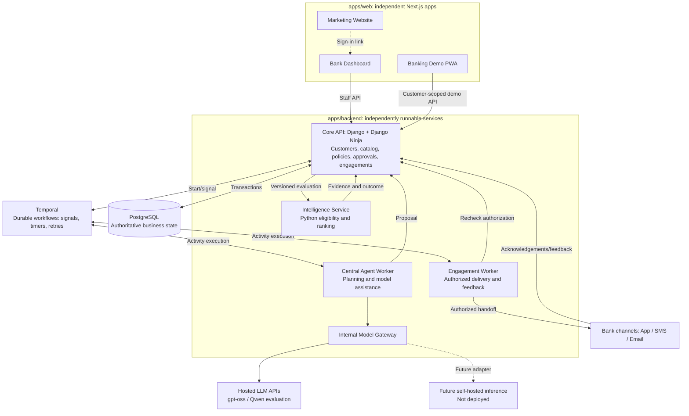
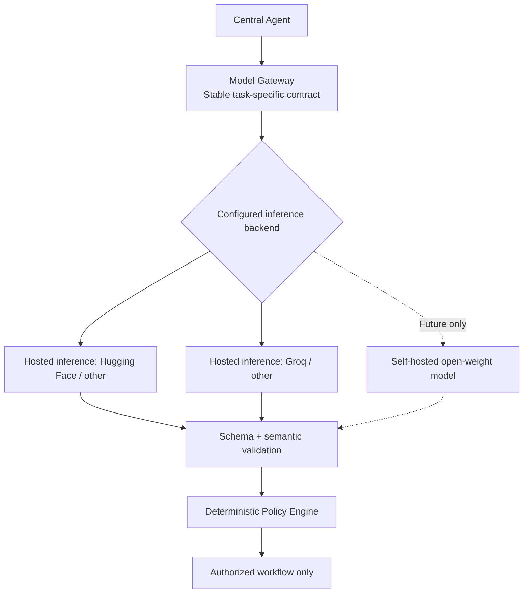

# Cuebik — System Architecture

**Version:** 0.3.0  
**Status:** Working draft — approved direction with open implementation decisions  
**Updated:** 12 October 2026

> **Document scope:** This document records agreed technologies and proposed implementation details. Approved decisions are distinguishable from unresolved vendor, workload, security, and configuration choices. [`PRODUCT.md`](PRODUCT.md) remains authoritative for product behavior. No unimplemented infrastructure or real integrations are represented as operational.

## 1. Technology decisions and open evaluations

The team has approved several technologies and architectural directions. Remaining choices are marked explicitly; **agreement does not substitute for implementation, testing, or security validation**.

| Product responsibility | Selected technology / candidate | Why it fits Cuebik | Decision status |
| --- | --- | --- | --- |
| **Operational database** | PostgreSQL | Transactions and relational integrity for approvals, policies, catalog versions and engagements; enables bank-scoped access enforcement. | **Approved** |
| **Backend language** | Python | Mature ecosystem for financial feature engineering, ranking, evaluation and backend integrations. | **Approved** |
| **Backend framework** | Django + Django Ninja | Data modeling, transactions, existing authentication primitives and typed OpenAPI endpoints suit the transactional core. | **Approved** |
| **Data validation & API contracts** | Validated typed schemas + OpenAPI | Keeps dashboard, PWA and services aligned through versioned runtime-validated contracts. | **Approved direction**; schemas pending |
| **Customer feature processing** | Python; Polars/pandas/NumPy to evaluate | Converts permitted banking summaries into traceable customer features with freshness/uncertainty. | **Python approved**; libraries pending |
| **Recommendation Engine** | Python eligibility rules + explainable ranking | Keeps mandatory restrictions separate from relevance, returns traceable Recommend / Clarify / Suppress outcomes. | **Approved approach**; ML tooling pending |
| **ML tooling** | scikit-learn baseline; LightGBM if useful | Supports repeatable evaluation without claiming that synthetic labels establish real-world quality. | **Candidates** |
| **Central Agent** | Structured Python orchestration + internal Model Gateway | Coordinates whether/when/how with model-independent typed proposals; model never authorizes engagement. | **Approved direction**; framework pending |
| **Policy evaluator** | Versioned deterministic rules | Produces testable Automate / Review / Withhold decisions independent of generated language. | **Approved approach**; rule schema pending |
| **Durable workflows** | Temporal Python SDK, Temporal Cloud intended managed control plane | Persists waiting approvals, timers, retries and worker progress across failures without using HTTP requests as durable state. PostgreSQL remains business authority. | **Approved**; cloud pricing and operations pending |
| **Web frontend** | React + TypeScript (Next.js) | Reusable UI and typed data models across independently deployed web applications. | **Approved** |
| **Web framework** | Next.js + TypeScript | Powers separate deployable marketing, staff dashboard and banking PWA applications with one web ecosystem. | **Approved** |
| **Customer banking demo** | Next.js installable PWA | Demonstrates a fictional bank experience on supported Android browsers without native Android infrastructure; real recommendation state comes from the Core API. | **Approved** |
| **Authentication** | Application-managed using proven Django security primitives | Protects staff access and privileged operations without requiring an identity SaaS at the outset; sessions, MFA and credentials need detailed design. | **Approved approach**; mechanics pending |
| **Hosting & deployment** | Separately deployable application/worker infrastructure + managed PostgreSQL | Allows independent releases/resources while retaining authoritative transactional storage. | **Direction approved**; vendors and regions pending |
| **Observability** | OpenTelemetry-compatible instrumentation | Correlates errors and traces across recommendation, agent, approval, policy and engagement workflows. | **Approved**; backend pending |

### 1.1 Decision boundaries

- **Approved:** The technology/direction is selected; concrete configuration, integration and acceptance tests may still be outstanding.
- **Approved direction:** The architectural approach is agreed, but an implementation library or provider is not yet selected.
- **Candidate:** Must be validated before adoption.

Decisions must be evaluated as a system: Temporal orchestration must coordinate safely with PostgreSQL business state; LLM results must not bypass policy enforcement; the banking PWA must not fabricate engagement delivery.

## 2. Proposed application and service boundaries

The product has three client experiences and several distinct platform responsibilities. Cuebik should support independently deployable applications **without treating every product module as an independent microservice**. Organization-scoped authorizations, catalog versions, policy evaluation, approvals, and engagement state require a shared transactional authority.

### 2.1 Editable service diagram

This Mermaid diagram renders natively in GitHub. It represents the proposed functional and deployable boundaries, not deployed infrastructure or real bank integrations.



**Important boundaries:**
- The public website is separate from the authenticated operational dashboard; it does not need customer data access.
- The installable banking PWA portrays a fictional bank customer experience, not a mobile staff dashboard. It requires customer-scoped access; seeded bank data must not replace Core API-backed recommendations and feedback.
- The Core Platform API owns authorized transactional state and applies final authorization. External compute services cannot directly grant approvals or send engagements on their own.
- The Recommendation Service returns structured **Recommend / Clarify / Suppress** decisions and evidence. It does not own approval, policy or delivery records.
- The Agent Worker proposes **whether/when/how**. The Engagement Worker handles scheduled handoffs and feedback, but must revalidate current permissions and policy before external delivery.
- The Model Gateway lives initially within the Agent service and calls hosted inference APIs; future self-hosted inference remains an adapter capability, not an initial deployment. Temporal manages durable workflow progression while Core API + PostgreSQL govern business authorization.
- The diagram is logical: exact protocols, worker infrastructure, network trust boundaries and database topology remain undecided.

### 2.2 Deployment responsibilities and their justification

| Component | Proposed boundary | Why |
| --- | --- | --- |
| **Marketing website** | Independent web application and deployment | Content, SEO, caching and release cadence differ from internal banking operations. |
| **Banking dashboard** | Independent authenticated web application and deployment | Bank staff need rich, secured operations independent of public site releases. |
| **Banking PWA** | Independent installable Next.js web application | Demonstrates customer notifications and feedback without a native Android build; scoped API ensures only approved offers appear. |
| **Core Platform API** | Independent backend deployment | Owns authoritative bank-scoped data and consequential policy/approval/engagement transitions. |
| **Intelligence & Recommendation Service** | Independently testable Python service; separate deployment candidate | Feature processing and ML evaluation may require independent resources and model release cycles. |
| **Agent orchestration** | Separate worker runtime; independent deployment if justified | Planning and optional language inference should not block interactive requests. |
| **Engagement execution** | Python Temporal worker, independently runnable | Durable timers, retries, feedback and idempotency with final Core API checks before dispatch. |
| **LLM inference** | Hosted provider initially; self-hosted support future-only | No current GPU/VPS operation; internal gateway keeps provider replacement possible. |
| **Catalog, Customers, Policies and Approvals** | Modules in the Core Platform API initially | Shared transaction, version and authorization requirements make premature decomposition risky. |

**A folder is not automatically a standalone service.** Meaningful independence requires an explicit contract, build/test configuration, well-defined data ownership and operational responsibility. No independent service may use another service's private database tables as an undocumented API.

The Core API must preserve references to input evidence, product versions, policy versions, authorization decisions and status events. A scheduled or retried job must not send a message under stale consent, approval or product terms. Temporal Activity boundaries, outbox/locking, cancellation and idempotency still require detailed design. Temporal does not replace PostgreSQL as the authoritative business record.

## 3. Approved monorepo organization

The **directory organization** is approved; this is the target structure, not a claim that application directories have already been scaffolded. Every deployable app/service is nested under `apps/`, grouped by category.

```text
cuebik/
├── BRAND.md
├── PRODUCT.md
├── ARCHITECTURE.md
├── apps/
│   ├── web/
│   │   ├── DESIGN.md          # Shared Cuebik design rules for marketing/dashboard
│   │   ├── marketing/         # Next.js public website
│   │   ├── dashboard/         # Next.js bank employee portal
│   │   └── banking-pwa/       # Next.js fictional bank PWA
│   └── backend/
│       ├── api/               # Django + Django Ninja authoritative core
│       ├── intelligence/      # Python customer features/recommendations
│       ├── agent/             # Central Agent + Model Gateway
│       └── engagement/        # Python Temporal engagement workers
├── packages/
│   ├── contracts/             # Shared, versioned API schemas and clients
│   └── ui/                    # Shared Cuebik web UI where applicable
├── infra/                     # Deployment configuration and Temporal environment
└── assets/
    └── brand/                 # Shared approved brand assets
```

**Document-location note:** The existing root-level `DESIGN.md` has **not yet moved**. It currently governs the Cuebik landing site and bank dashboard. When app folders are physically created, move it to `apps/web/DESIGN.md` and update all links together. It does not govern the fictional bank PWA's visual identity.

Applications retain independent builds and deployments. Core modules share authorized state; separate services use documented contracts. No `services/` or `infrastructure/` top-level directory is planned, and no initial GPU/model-server application directory is required.

## 4. Python and intelligence components

**Approved direction:** Python is the primary backend and intelligence language; Django + Django Ninja is selected for the transactional Core API. ML, agent and provider implementation details still require evaluation.

| System | Language/runtime direction | Reason |
| --- | --- | --- |
| Core Platform API | Python with Django + Django Ninja | Mature transactions, domain models, authentication foundation and typed APIs. |
| Customer ingestion & feature engineering | Python numerical/data ecosystem | Normalize authorized financial activity and track facts, inferences, freshness and missing values. |
| Eligibility & Recommendation Engine | Python rules and ranking | Hard product restrictions must remain separate from statistical relevance. |
| Training & evaluation | Python ML tooling | Supports repeatable baselines and measured model comparisons; learned ranking requires appropriate labels. |
| Central Agent | Python orchestration, optional LLM assistance | Coordinates structured proposals and model calls without giving the model authority. |
| Policies & Automation | Deterministic, versioned rule evaluation | Enforce **Automate / Review / Withhold** independent of generative model output. |
| Engagement execution | Python Temporal Activity workers | Durable scheduling and recovery with final Core API authorization before delivery. |
| LLM serving | Hosted model API via Model Gateway; future self-hosted adapter | Avoids initially operating GPU inference infrastructure. |
| Client applications | Next.js + TypeScript (marketing, dashboard, banking PWA) | Three independently deployable web experiences, each with its own identity and access model. |

**Do not equate the Recommendation Engine with an LLM.** It must evaluate authorized customer evidence against currently active products, eligibility restrictions and potentially a ranking model, returning **Recommend / Clarify / Suppress** and evidence. The agent may assist with proposals or wording; neither model output nor an earlier recommendation authorizes contact.

## 5. Model Gateway and provider portability

**Approved approach:** The Central Agent communicates through its internal Model Gateway with **hosted model APIs initially**. Support self-hosted open-weight models in the gateway contract for a later phase, but do not provision GPU/VPS model-serving infrastructure now. gpt-oss and Qwen are evaluation candidates; no specific production provider or failover path has passed acceptance testing.



### 5.1 What the gateway owns

- **Provider routing:** Select model/provider/revision and endpoint from protected configuration; do not hardcode vendor calls in agent business logic.
- **Stable contracts:** Accept permitted context/allowed actions and return a typed, structured proposal rather than executable permission.
- **Validation:** Check response schema and business semantics; reject invented rates, unsourced claims, disallowed channels, unsupported evidence references and invalid action types.
- **Reliability:** Normalize timeouts, failures, rate limits and bounded retries. A failed model call must not authorize engagement.
- **Traceability:** Record model/provider/prompt versions, request IDs and evaluation metadata without logging sensitive customer content unnecessarily.
- **Migration safety:** Test a replacement on the same Cuebik-specific task suite before activating it; API compatibility alone does not guarantee equivalent output or tool calling.

A gateway can be an internal agent module initially. Independent deployment becomes a separate operational decision. The LLM may propose content or action; the Policy Engine remains the authority for **Automate / Review / Withhold**, and the Core API validates the final dispatch state.

### 5.2 Where Hugging Face fits

Hugging Face is **a model discovery, distribution and inference platform**, not one mandatory model that Cuebik must use.

| Hugging Face capability | How Cuebik could use it | Important qualification |
| --- | --- | --- |
| **Model Hub** | Discover, evaluate and download open-weight models; inspect licenses, model cards and pinned revisions. | Licenses, gated access, suitability and model-code risks differ by model. |
| **Inference Providers** | Evaluate hosted models with a common Python/HTTP interface without first operating GPUs. | Requests are routed via Hugging Face and real inference providers; review privacy, geography, billing and provider-specific behaviour. |
| **Dedicated Inference Endpoints** | Deploy an approved model through managed compute with selected hardware and scaling. | Dedicated managed inference is still third-party hosting; region and network security require review. |
| **Self-hosted downloaded models** | Serve licensed weights using a chosen runtime such as vLLM where supported. | Requires compute, monitoring, secure serving, licensing checks and model version management. |

Relevant official references:
- Hugging Face Model Cards: https://huggingface.co/docs/hub/model-cards
- Hugging Face Gated Models: https://huggingface.co/docs/hub/models-gated
- Hugging Face Inference Providers: https://huggingface.co/docs/inference-providers/index
- Hugging Face Inference Endpoints: https://huggingface.co/docs/inference-endpoints/about
- Hugging Face Endpoint security: https://huggingface.co/docs/inference-endpoints/security
- vLLM compatible API/security: https://docs.vllm.ai/en/latest/serving/online_serving/openai_compatible_server/

**Decision state:** Hosted inference is approved initially, with gpt-oss and Qwen as evaluation candidates. Hugging Face remains an optional model discovery/inference platform. Actual provider, pricing, privacy terms, model/version and failover still need validation; self-hosting is deferred.

### 5.3 Model and customer-data safeguards

External inference changes where bank-derived data is processed. Apply data minimization; avoid raw credentials, full banking histories or sensitive identifiers for message drafting; assess actual service contracts, retention, routing, residency and access controls before using real data. Self-hosted inference still requires model provenance, dependency and runtime security reviews. Invalid/unavailable model output fails safely, without assuming permission.

## 6. Confirmed decisions and remaining work

**Confirmed:** PostgreSQL; Python + Django/Django Ninja for Core API; deterministic eligibility and bank policy checks; Next.js/TypeScript independently deployed marketing, dashboard and **installable banking PWA**; application-managed staff authentication; an internal Model Gateway; **hosted LLM inference initially** with gpt-oss and Qwen candidates; **Temporal durable workflows with Python workers**, local development server and Temporal Cloud intended for managed orchestration; OpenTelemetry instrumentation; and monorepo directories `apps/`, `packages/`, `infra/`, `assets/`.

**Unresolved details that must not be presented as implemented:** Temporal Cloud account, regional suitability, pricing, usage budget, workflow histories/retry/cancellation design; worker hosting; data/permission contracts; actual model/provider selection and evaluation; ML baseline/training evidence; authentication security settings; hosting vendors; secrets, telemetry backend, recovery and SLOs.

**Customer demo guarantee:** A PWA may use seeded account/transaction screens, but must retrieve approved recommendations via authorized API endpoints and report actual customer feedback. Approval, send, delivery and viewing remain distinct facts.

**Temporal guarantee boundary:** Temporal persists workflow progression; it does not independently authorize an engagement, make external dispatch exactly once, or replace PostgreSQL business state. Workers must verify current consent, catalog terms, policy and approval immediately before handoff and protect against retries/duplicates.

**Repository migration:** The current root `DESIGN.md` stays until the new app folders are created. Move it to `apps/web/DESIGN.md` and update references together at scaffolding time. Do not confuse the Cuebik design system with the fictional bank's PWA styling.

PR remains a draft for architecture completion and validation.
